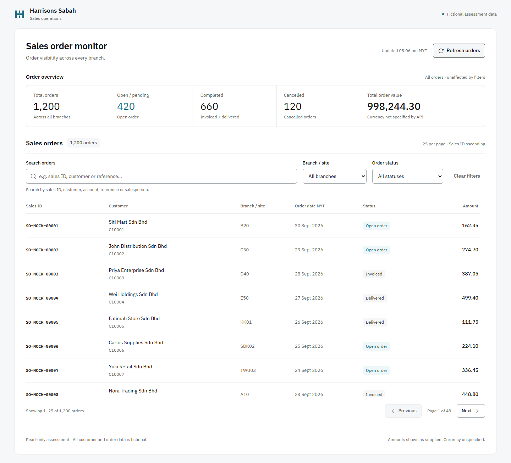
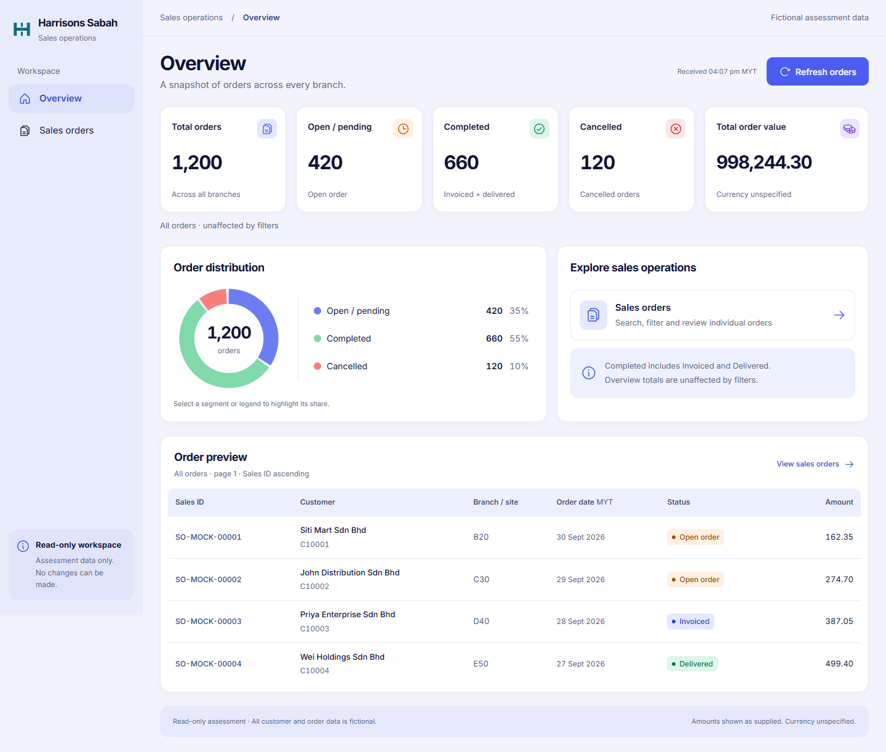
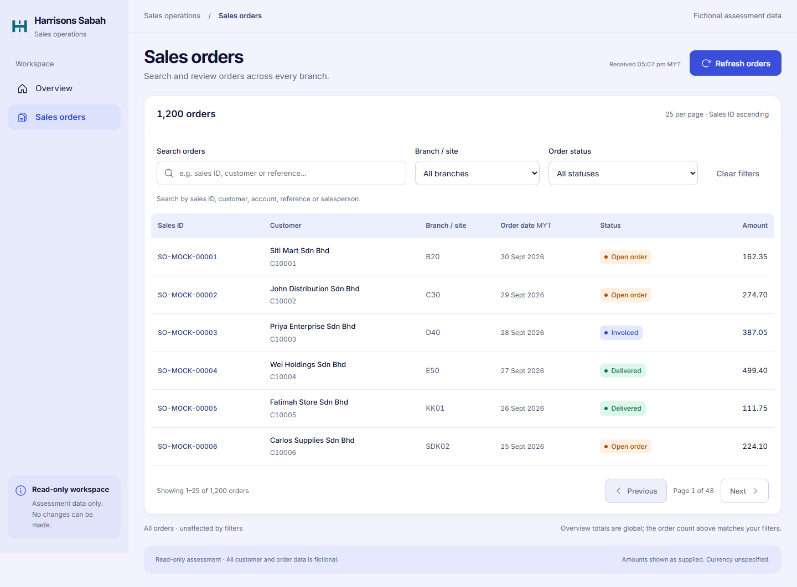
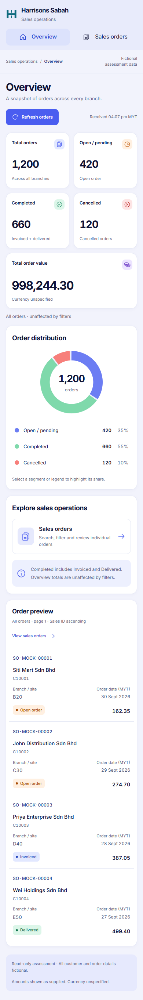
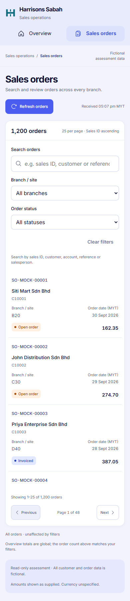

# Harrisons Sales Order Monitor

**Classic remains the PRIMARY assessment submission.** This branch contains **Enhanced, an ALTERNATIVE UI**, based on the supplied HTML design reference. All customers and orders are fictional assessment data; both versions use only the supplied read-only company API.

Latest focused motion refinement: [cause, changes, verification and timing](docs/MOTION_REFINEMENT.md). Cards now enter after real data arrives, with a 560ms staggered reveal; the donut draws over 900ms, view/navigation transitions take 300ms, and fine-pointer hover/press feedback follows the reference. Classic remains unchanged.

| Version | Submission role | Public app | Source | Screenshot | Design / motion |
| --- | --- | --- | --- | --- | --- |
| Classic | **PRIMARY** | [Open Classic](https://harrisons-sales-order-monitor.vercel.app) | [`main`, pinned application baseline `3bc82a5`](https://github.com/liewww89/harrisons-sales-order-monitor/tree/3bc82a511901f77638e3ee19af399c0875afb84d) | [Desktop](docs/screenshots/classic-desktop.png) | Single working dashboard; quiet table/button feedback. |
| Enhanced | **ALTERNATIVE UI** | [Open Enhanced](https://harrisons-sales-order-monitor-enhan.vercel.app) | [`design/enhanced-ui`, application `0d97fd6`](https://github.com/liewww89/harrisons-sales-order-monitor/tree/0d97fd65cc7ecd9c5ad524973fcd371858a09724) | [Overview](docs/screenshots/enhanced-overview-desktop.png), [Orders](docs/screenshots/enhanced-orders-desktop.png), [Mobile](docs/screenshots/enhanced-orders-mobile.png) | Lavender workspace, sidebar/mobile navigation, five statistic cards, interactive donut, order preview, bounded reveals and real-request refresh motion. |

## Run and verify Enhanced

Use Node 22.x (tested with 22.23.2), npm and installed Chrome for browser tests. No account, database or environment variables are needed by the application.

```powershell
npm.cmd ci
npm.cmd run dev -- --port 5174 --strictPort
```

Open [local Overview](http://127.0.0.1:5174/#overview) or [local Sales orders](http://127.0.0.1:5174/#orders). Hash navigation supports direct entry, refresh and browser history. Queries/pages persist across view switches and reset on a full reload.

```powershell
npm.cmd run typecheck
npm.cmd run lint
npm.cmd test
npm.cmd run build
npm.cmd run test:e2e
npm.cmd run check:contract
node scripts/capture-screenshots.mjs
```

The contract and screenshot commands need the dev server running. For production checks, set `APP_URL` to the verified deployment origin before running the same commands. Local and production Playwright suites must run sequentially in a checkout so their report directories do not collide. The production output is `dist/`.

## API and source structure

Base URL: `https://hiring.harrisons.my/api/mock/sales-orders`. The client sends only GET with the public fixture header `x-assessment-key: hssb-assessment-mock-2026`. `/meta` supplies all branch/status options. The API handles `q`, `site`, `status`, `page` and `pageSize=25`; there is no generated production dataset, local order filtering, writable backend or database.

| Source | Responsibility |
| --- | --- |
| `src/api.ts`, `src/types.ts` | Existing GET-only client, observed fields, runtime validation, errors and timeout. |
| `src/query.ts`, `src/useApiResource.ts` | Existing query encoding, page resets, status mapping, abort/stale-response guards, independent resource loading/retry. |
| `src/App.tsx`, `src/navigation.ts` | Shared active query, 300ms debounce, hash views, refresh status and page composition. |
| `src/components/Dashboard.tsx` | Five real summary values; financial amounts show immediately. |
| `src/components/Distribution.tsx` | API-derived SVG/legend; keyboard/touch highlighting; cancellable draw animation. |
| `src/components/Navigation.tsx`, `OrderTable.tsx` | Semantic responsive navigation, table/card rows and scrollable sticky headers. |
| `src/useReducedMotion.ts`, `src/styles.css` | Live JavaScript media preference and matching CSS reduced-motion overrides. |
| `tests/`, `src/*.test.ts` | 19 browser tests and 32 retained unit tests. |

The API summary describes all 1,200 orders except `filtered_orders`, which equals the filtered list total. Five cards and donut use the same global summary: total 1,200; open 420; completed 660 (Invoiced + Delivered); cancelled 120; order value 998,244.30. Labels distinguish global values from the current selection. Unknown statuses retain their source text and warn; residual summary counts appear unclassified.

**Currency and scale are unspecified by the API.** Values keep their original decimal scale, with two decimal places and no assumed MYR symbol. Dates use Asia/Kuala_Lumpur. “Order preview” means four rows of the current query/page in SalesId ascending order; it does not claim the latest records. Sorting/page-size controls are intentionally omitted.

Metadata/list failures are independent. Search works when metadata fails; each resource can retry. Old requests are cancelled and cannot replace newer results. No fake rows appear on failure, no artificial wait is used, and received timestamps require actual successful order responses.

## Verification, disclosure and timing

The final local implementation passed type checking, lint, build, **32 unit tests** and **19 Chrome browser tests (37.3s)**. The public Enhanced app passed the **same 19 browser tests (37.6s)**, anonymous HTTPS, real API authentication/CORS and byte-for-byte JS/CSS comparison with the tested build. Classic passed all **9 original production tests (20.4s)** again and its public JS/CSS hashes remain unchanged. Successful integration uses the real company API. Failure/delay interception and temporary long-text DOM probes are disclosed test-only checks. See [the delivery record](docs/ENHANCED.md) for all three verification gates, isolation/deployment details, motion timings, actual work time, known limits and an optional English recruitment-form note.

ChatGPT assisted with prompt preparation; Codex performed substantial implementation, API inspection, test execution, screenshot review, documentation and deployment assistance. These are agent-executed checks, not applicant personal review or independent runtime model attestation. The applicant should review and understand the code. The hiring form has not been submitted.

Original Classic documentation is preserved in [SUBMISSION.md](SUBMISSION.md), [WORK_LOG.md](docs/WORK_LOG.md), [VERIFICATION.md](docs/VERIFICATION.md), [UI_POLISH.md](docs/UI_POLISH.md) and [HANDOVER.md](docs/HANDOVER.md). Their earlier counts/timings describe Classic; this branch's additional work is recorded separately in [ENHANCED.md](docs/ENHANCED.md).

## Screenshots from the actual API-connected apps

Classic — **PRIMARY**:



Enhanced Overview — **ALTERNATIVE UI**:



Enhanced Sales orders:



Enhanced mobile:



